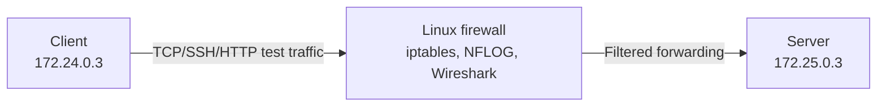

# Linux Firewall: Traffic Filtering with iptables

**Focus:** Network security · Linux · iptables · Wireshark · troubleshooting  
**Course context:** CSCI 412 (Information Security), John Jay College of Criminal Justice  
**Status:** **Completed in an isolated Labtainer environment.** Four screenshots below are extracted from the submitted lab report; the HTTP counter screenshot is in the downloadable portfolio archive.

## Goal
Configure a Linux firewall between a client and a server. Permit explicitly allowed services, block disallowed traffic, inspect connection attempts, and verify security rules using logs, packet captures, and packet counters.

## Lab topology

These IP addresses belong to the isolated course lab. They are **not** public production infrastructure.

## Tools
- Linux / Ubuntu terminal, Bash
- `iptables` and `iptables` connection state matching (`conntrack`)
- Wireshark for inspection of TCP SYN attempts
- SSH, `wget`, the lab's `wizbang` test program
- `tail` for firewall log inspection

## Work performed
1. Inspected initial filter chains (`sudo iptables -L -v -n`); they had default ACCEPT policies.
2. Executed the course's `example_fw.sh`, which cleared rules and set DROP policies.
3. Inspected stateful forwarding rules that allowed established/related sessions and TCP destination port 22 (SSH).
4. Attempted SSH on port 2222; observed blocked connection attempts logged with `IPTABLES DROPPED` and destination port `2222`.
5. Inspected Wireshark SYN attempts to the lab's TCP port `10071`, inserted an ACCEPT rule for that client→server service, and successfully retried `./wizbang server`.
6. Placed a more specific HTTP DROP rule ahead of other forwarding rules; `wget` then timed out.
7. Reapplied the edited firewall script and inspected the resultant counters and ordering.

## Results: original screenshots

**Firewall script configuration:** default DROP and explicit SSH allow, with an NFLOG rule for unmatched traffic.  

**Firewall drop log:** blocked attempts to TCP port 2222 (see submitted report for surrounding explanation).  

**Application/service testing:** successful `wizbang` test after an explicit TCP port 10071 permit.  

**HTTP blocking verification:** `wget` times out; the HTTP DROP rule showed **5 packets / 300 bytes**.  
The original HTTP timeout and counter screenshot is retained in the [complete portfolio archive](https://github.com/eronivaka-svg/linux-firewall-iptables-lab) only as documented coursework; image upload is pending. The screenshot is included in the downloadable project ZIP.

**Configuration reapplied:** script saved and run again, with `sudo iptables -L` confirming updated rules.  

### Observations
| Test | Observed outcome | Evidence |
| --- | --- | --- |
| Initial firewall listing | ACCEPT policy, no filter rules | Original submitted report |
| SSH to non-allowed port 2222 | Dropped; `IPTABLES DROPPED` entries with TCP SYN | Original log screenshot |
| Custom service to TCP port 10071 | Connected after adding explicit permit rule | Terminal output screenshot |
| HTTP from client to server | `wget` timed out | Terminal output screenshot |
| HTTP blocking counters | Rule matched 5 packets / 300 bytes | Rule-counter screenshot |
| Reapply after editing script | Rules visible after running script again | Final screenshot |

## Configuration and reproducibility
- [`configs/lab-firewall-reconstruction.sh`](configs/lab-firewall-reconstruction.sh) is an **annotated reconstruction** from the screenshots and documented commands. It is not represented as the byte-for-byte source of the original `example_fw.sh`.
- [`notes/observed-commands.md`](notes/observed-commands.md) separates the commands/results supported by the original report from the reconstructed script.

> [!CAUTION]
> Do **not** run the reconstructed script on your laptop, normal Linux host, home router, or cloud server. It changes default firewall policies to DROP and can cut off your network/SSH access. It is guarded and intended **only** for a disposable isolated Labtainer firewall container after reviewing the contents.

## What I would improve
- Export an original `iptables-save` ruleset in addition to screenshots, so rules can be compared with a known state.
- Record a short test matrix with timestamps, source/destination, port, expected result, and measured result.
- Add safe reset/rollback handling and demonstrate restoration after restarting the lab (a saved script alone does **not** prove boot-time persistence).
- Automate rule verification inside a disposable network namespace or VM.

## Academic integrity and provenance
The testing, observations, and screenshots come from completed CSCI 412 coursework. The original lab PDF contains the screenshot evidence. The annotated script in this repository was **reconstructed later for the public portfolio** from the submitted report and is labelled accordingly. No enterprise environment or professional employment is claimed.
