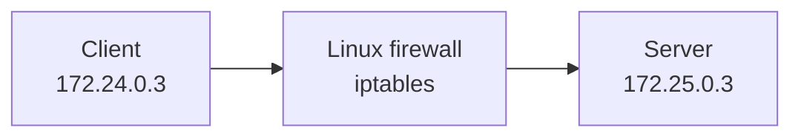
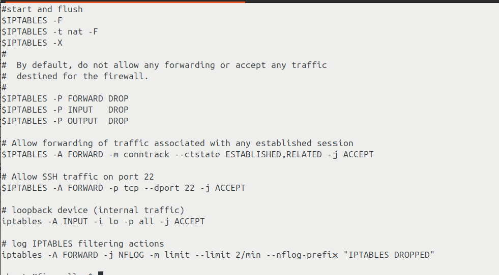
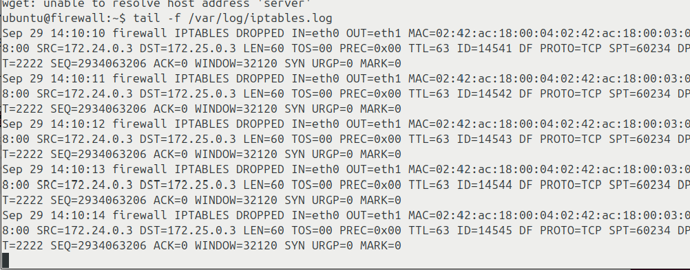
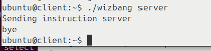
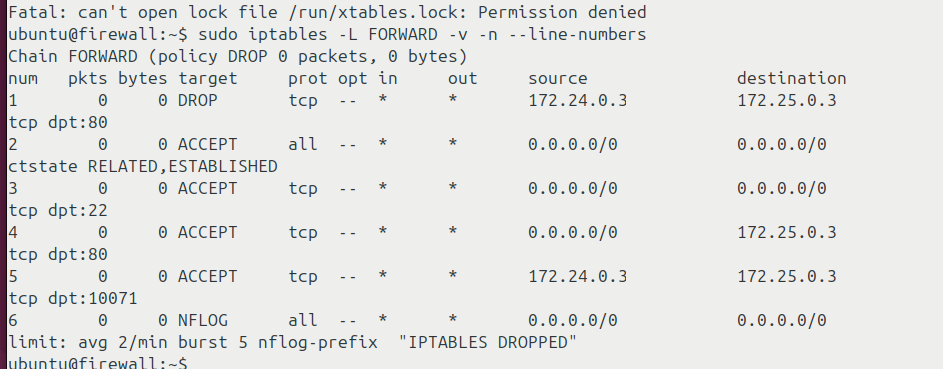

# Linux Firewall Lab: Packet Filtering with iptables

A hands-on firewall exercise completed for **CSCI 412: Information Security** at John Jay College of Criminal Justice.

## Objective

Configure a Linux firewall between a client and server, control which TCP connections can pass, and verify the outcome using packet inspection, firewall logs, and rule counters.

## Topology

The addresses are private addresses from an isolated Labtainer environment.

## Tools

Linux, Bash, iptables, Wireshark, SSH, wget, and firewall log inspection.

## Procedure and observations

| Test | Action | Observed result |
| --- | --- | --- |
| Baseline | Listed the filter chains with `sudo iptables -L -v -n` | The initial chains used ACCEPT policies |
| Default-deny | Ran the course-provided `example_fw.sh` | The configuration applied DROP policies and allowed selected traffic |
| Blocked SSH port | Tried `ssh -p 2222 server` | Log entries showed TCP SYN attempts dropped for destination port 2222 |
| Additional service | Inspected TCP SYN packets for port 10071 and added a targeted ACCEPT rule | The lab's `wizbang` service completed successfully |
| HTTP block | Inserted a client-to-server DROP rule for TCP port 80 | `wget` timed out; the recorded rule counter reached 5 packets / 300 bytes |
| Verification | Reran the modified firewall script and inspected the rule listing | Updated rules appeared in the expected order |

## Evidence from my lab submission

These are screenshots from the original CSCI 412 lab report, not generated examples.

**Firewall configuration**

**Rejected SSH connection**

**Service allowed after rule change**

**Final rule listing**

The submitted lab report also recorded the `wget` timeout and HTTP DROP counter. Its separate screenshot is not included here; the four images above are the evidence currently published.

## What I learned

Firewall rule order matters. A broad allow rule can override the intent of a later deny rule, while a default-deny policy requires explicit permissions for the services being tested. Logs, packet captures, and rule counters help distinguish a networking fault from intentional filtering.

## Possible improvements

- Save the original `iptables-save` output alongside the screenshots.
- Turn the tests into a repeatable table of allowed/blocked connections with timestamps.
- Test restoring rules after a container restart and document a rollback process.

**Scope:** Academic network lab, not a production firewall deployment. The original course script was not preserved in this repository; I have chosen to publish the genuine test evidence rather than a reconstructed substitute.
